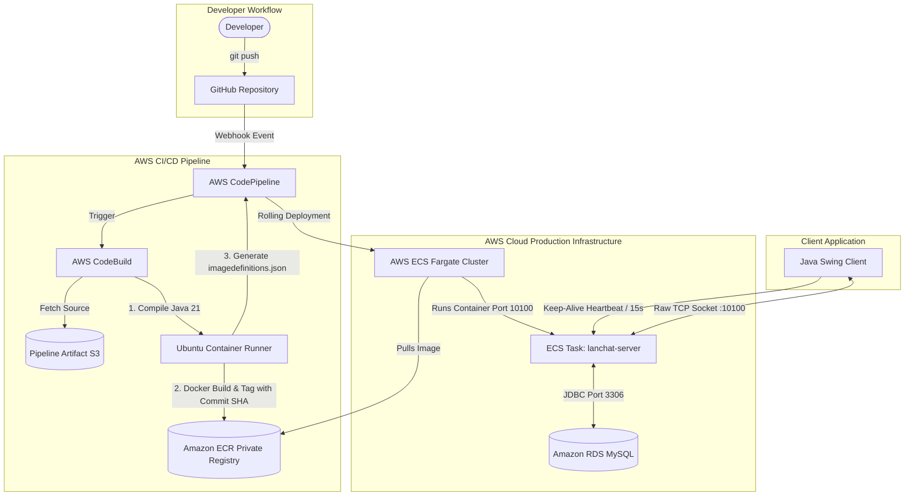

# CloudChat: Enterprise CI/CD & Cloud Orchestration on AWS


An enterprise-grade, cloud-native real-time chat infrastructure deployed on AWS with a fully automated, zero-downtime CI/CD pipeline. 

Starting from a raw Java Socket server, this project was containerized with Docker, backed by Amazon RDS (MySQL), hosted on AWS ECS Fargate, and wired into an automated CI/CD pipeline triggered by Git commits via AWS CodePipeline and AWS CodeBuild.

---

## 🏛️ Architecture Overview



---

## 🚀 Key Engineering Highlights

### 1. Automated CI/CD with Dynamic Versioning
* **Git Commit Tagging:** Instead of generic `:latest` tags, [`buildspec.yml`](buildspec.yml) automatically extracts the 7-character Git commit hash (`cut -c 1-7`) and tags each Docker image dynamically.
* **Orchestration:** Changes pushed to GitHub trigger an instant webhook into **AWS CodeConnections / CodePipeline**, spinning up **AWS CodeBuild** on an ephemeral runner.
* **Zero-Downtime ECS Handover:** CodeBuild emits an `imagedefinitions.json` artifact that tells ECS to perform a rolling swap of tasks without dropping client traffic.

### 2. Low-Level Stateful Networking
* Built on raw Java `java.net.Socket` and `ServerSocket` rather than abstracted HTTP frameworks.
* Managed concurrent client sessions safely using `ConcurrentHashMap<String, PrintWriter>` across dedicated worker threads (`Client_handler`).

### 3. Application-Layer TCP Keep-Alive Heartbeat
* **The Challenge:** Cloud infrastructure (AWS NAT Gateways and intermediate routers) silently drops idle TCP socket connections after 60 seconds of silence.
* **The Solution:** Engineered a custom background daemon thread in the client that transmits periodic `PING` heartbeats every 15 seconds, preventing silent drops and maintaining persistent real-time duplex connections.

### 4. Decoupled Persistence Layer (AWS RDS)
* Application state and user accounts are entirely decoupled from the ephemeral container lifecycle.
* Managed **Amazon RDS MySQL 8.0** handles user credentials, relational chat rooms, and message histories.
* Includes resilient reconnection logic and automatic schema initialization (`CREATE TABLE IF NOT EXISTS`).

### 5. Cross-Platform Containerization
* Packaged with a multi-stage Docker build using `amazoncorretto:21` on Linux.
* Designed with platform-agnostic file separators and clean classpath bundling to eliminate Linux/Windows path traversal discrepancies.

---

## 📂 Repository Structure

```text
├── buildspec.yml                    # AWS CodeBuild instructions (phases, ECR push, imagedefinitions.json)
├── README.md                        # Project documentation
└── myproj/
    ├── lc_server/                   # Backend Server Component
    │   ├── Dockerfile               # Container packaging using Amazon Corretto 21
    │   ├── lib/                     # Dependency libraries (BCrypt, byte utils)
    │   └── server/
    │       ├── Server.java          # Server entry point, thread pool, socket listener (:10100)
    │       ├── Client_handler.java  # Individual client connection lifecycle & routing
    │       ├── Data_handler.java    # MySQL RDS connectivity & schema provisioning
    │       ├── Authorization.java   # User authentication & registration logic
    │       ├── ServerCryptUtil.java # BCrypt password hashing & salt generation
    │       └── Message_handler.java # Message parsing & dispatching
    │
    └── client/                      # Desktop Client Component
        ├── Client.java              # Client entry point, socket initialization, Keep-Alive daemon
        └── Services/
            ├── User_auth.java       # Swing Authentication GUI (Login / Registration CardLayout)
            └── ...                  # Chat windows & UI components
```

---

## ⚙️ Environment Variables

The server container requires the following environment variables configured in the AWS ECS Task Definition (or local `.env`):

| Variable | Description | Example |
| :--- | :--- | :--- |
| `DB_URL` | JDBC MySQL connection URL | `jdbc:mysql://lanchat-db.xxxx.ap-south-1.rds.amazonaws.com:3306/lanchat` |
| `DB_USERNAME` | Master database username | `admin` |
| `DB_PASSWORD` | Database user password | `YourSecurePassword123` |

---

## 🛠️ Local Development & Setup

### Prerequisites
* **Java Development Kit (JDK):** Version 21 or higher
* **MySQL Database:** Local instance or AWS RDS
* **Docker:** (Optional, for containerized local testing)

### 1. Compile & Run Server Locally
```bash
# Navigate to server directory
cd myproj/lc_server

# Set environment variables (PowerShell example)
$env:DB_URL="jdbc:mysql://localhost:3306/lanchat"
$env:DB_USERNAME="root"
$env:DB_PASSWORD="password"

# Compile and run
cd server
javac -cp ".:../lib/*" *.java
java -cp ".:../lib/*" Server
```

### 2. Run with Docker Locally
```bash
cd myproj/lc_server
docker build -t lanchat-server .
docker run -p 10100:10100 \
  -e DB_URL="jdbc:mysql://<host>:3306/lanchat" \
  -e DB_USERNAME="admin" \
  -e DB_PASSWORD="password" \
  lanchat-server
```

### 3. Run Client
```bash
cd myproj/client
javac -cp "." Client.java
java Client
```
* Enter the **Server IP** (use `localhost` for local testing or the **AWS ECS Task Public IP** for cloud testing).

---

## ☁️ AWS Cloud Infrastructure Setup

1. **Amazon ECR:** Create a private repository named `lanchat-server`.
2. **Amazon RDS:** Launch a MySQL 8.0 `db.t3.micro` instance (Free Tier) in the default VPC. Enable port `3306` from the ECS security group. Specify initial database name `lanchat`.
3. **Amazon ECS:** 
   * Create a Fargate cluster.
   * Define a Task Definition named `lanchat-task` with container `lanchat-server` exposing port `10100` and containing the DB environment variables.
   * Launch a Fargate Service with **Auto-assign Public IP: Enabled** and Security Group allowing TCP port `10100`.
4. **AWS CodePipeline & CodeBuild:** Connect to your GitHub repository and link `buildspec.yml` to build and push to ECR, then deploy artifacts to ECS.

---

## 👤 Author
* **Niraj** — Engineering and Cloud Architecture
